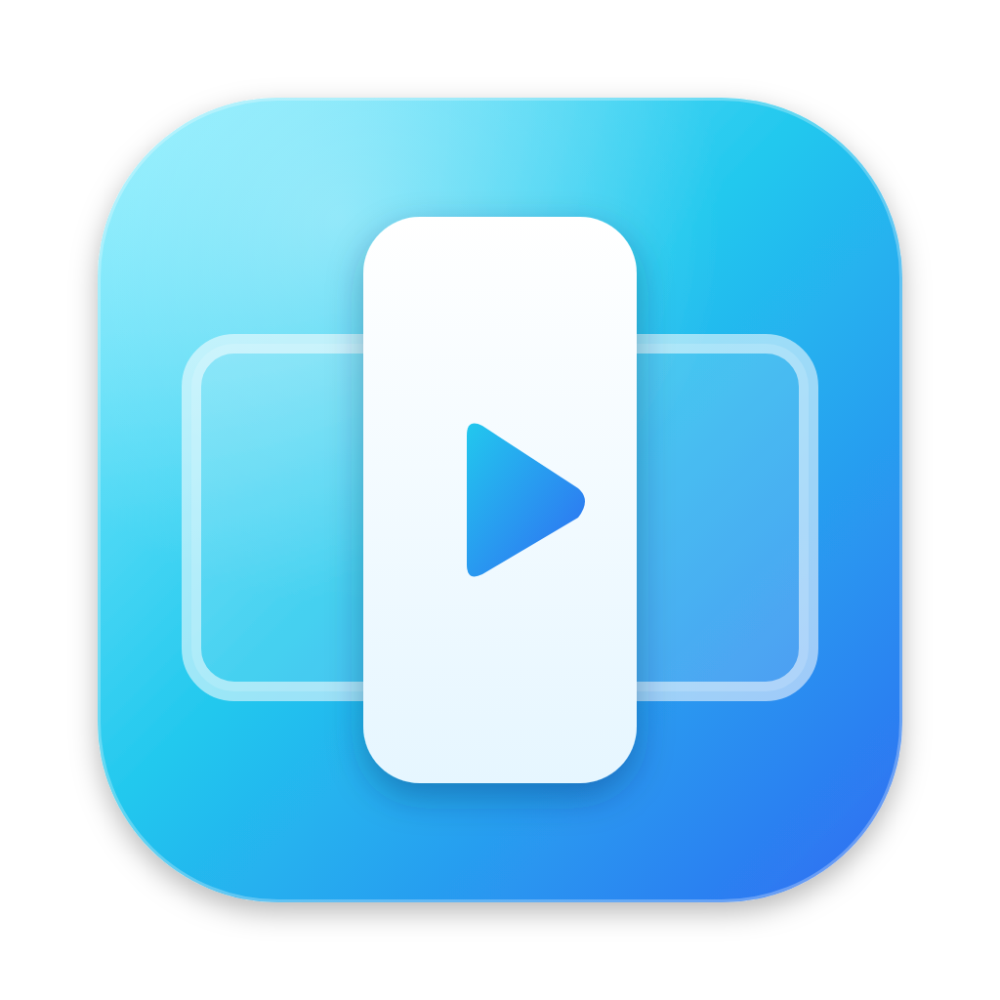
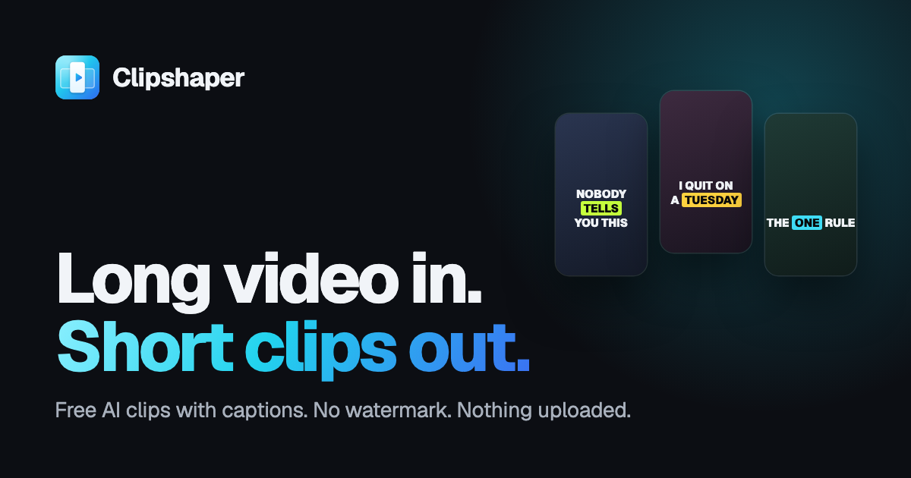

<p align="center">
  <a href="https://hollowbit.dev/clipshaper/"></a>
</p>

<h1 align="center">Clipshaper</h1>

<p align="center"><b>Long video in. Short clips out.</b></p>
<p align="center">Finds the best moments in a podcast, stream or talk, follows the speaker and adds word-by-word captions. No watermark, no account, and your video is never uploaded.</p>

<p align="center">
  <a href="https://github.com/hollowbit-dev/clipshaper/releases/latest"></a>
  
  
  <a href="LICENSE"></a>
</p>

<p align="center">
  <a href="https://hollowbit.dev/clipshaper/download.html"></a>
  <a href="https://hollowbit.dev/clipshaper/try/"></a>
</p>

<p align="center"></p>

## How it works

1. **Listen:** [whisper.cpp](https://github.com/ggml-org/whisper.cpp) writes down every word with timings.
2. **Pick moments:** a small local language model (Qwen, run with [llama.cpp](https://github.com/ggml-org/llama.cpp)) reads the transcript like an editor and scores each candidate clip.
3. **Frame:** [MediaPipe](https://ai.google.dev/edge/mediapipe) face detection drives a 9:16 crop that holds still, follows the speaker and jumps on cuts.
4. **Export:** ffmpeg burns in the captions and writes 1080×1920 MP4s.

The app can also download from YouTube, TikTok, Instagram, X, Twitch and more via [yt-dlp](https://github.com/yt-dlp/yt-dlp). Only use videos you own or have permission to use.

The web version (`docs/try/`) runs the same window code in the browser, with Whisper via transformers.js, the moment finder via WebLLM, and export by recording a canvas.

> Windows builds have not been tried on a real PC yet. If something breaks, please [open an issue](https://github.com/hollowbit-dev/clipshaper/issues/new).

## Install

Get the installer from the [website](https://hollowbit.dev/clipshaper/download.html) or the [latest release](https://github.com/hollowbit-dev/clipshaper/releases/latest).

- **Mac (Apple Silicon):** open the .dmg and drag Clipshaper to Applications. The first time, right-click it and choose **Open**, because the app isn't signed yet.
- **Windows:** run the installer. If SmartScreen appears, click **More info**, then **Run anyway**.

## Develop

```
npm install
npm start          # the app (needs vendor/ binaries, see scripts in Captionshaper/Writeshaper)
npm run site       # builds the website into docs/
node test/e2e.mjs  # app end to end
```

## More free apps from Hollowbit

- **[Melodyshaper](https://hollowbit.dev/melodyshaper/)**: hum a tune, make a song
- **[Captionshaper](https://hollowbit.dev/captionshaper/)**: offline auto subtitles
- **[Lightshaper](https://hollowbit.dev/lightshaper/)**: free photo editor
- **[Fileshaper](https://hollowbit.dev/fileshaper/)**: compress, convert, sign PDFs
- **[Writeshaper](https://hollowbit.dev/writeshaper/)**: offline writing assistant
- **[Moveshaper](https://hollowbit.dev/moveshaper/)**: move to a new computer
- **[Diskshaper](https://hollowbit.dev/diskshaper/)**: clean up storage
- **[Startshaper](https://hollowbit.dev/startshaper/)**: find out why your PC is slow
- **[Fuseduo](https://fuseduo.com/)**: automate your Mac apps

## Licence

GPL-3.0-or-later. See [LICENSE](LICENSE) and [THIRD_PARTY_NOTICES.md](THIRD_PARTY_NOTICES.md).

---

<p align="center"><sub>Made by <a href="https://hollowbit.dev">Hollowbit Studio</a>. If Clipshaper helped you, a ⭐ helps other people find it.</sub></p>
